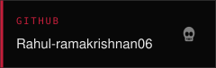
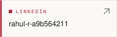
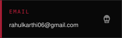

# Rahul R

**Data center to multi-cloud. Hardened pipelines. Measurable outcomes.**

DevSecOps infrastructure lead spanning on-prem data center and cloud (GCP, AWS, Cloudflare). Four-plus years automating CI/CD, IaC, zero-trust identity, and platform security — from Netgear and Sony Soneium to healthcare GenAI, now leading hybrid infra end to end.

<!-- The graph is generated. Edit the model in assets/knowledge-graph.py, then run: python3 assets/knowledge-graph.py -->

  <picture>
    <source media="(prefers-color-scheme: dark)" srcset="assets/knowledge-graph-dark.svg">
    <source media="(prefers-color-scheme: light)" srcset="assets/knowledge-graph.svg">
    
  </picture>

<!-- Drawn daily by .github/workflows/snake.yml and published to the output branch. -->

  <picture>
    <source media="(prefers-color-scheme: dark)" srcset="https://raw.githubusercontent.com/Rahul-ramakrishnan06/Rahul-ramakrishnan06/output/github-snake-dark.svg">
    <source media="(prefers-color-scheme: light)" srcset="https://raw.githubusercontent.com/Rahul-ramakrishnan06/Rahul-ramakrishnan06/output/github-snake.svg">
    
  </picture>

## Field kit

<!-- Generated: python3 assets/character-card.py  and  python3 assets/journey.py -->

  <picture>
    <source media="(prefers-color-scheme: dark)" srcset="assets/character-card-dark.svg">
    <source media="(prefers-color-scheme: light)" srcset="assets/character-card.svg">
    
  </picture>

  <picture>
    <source media="(prefers-color-scheme: dark)" srcset="assets/journey-dark.svg">
    <source media="(prefers-color-scheme: light)" srcset="assets/journey.svg">
    
  </picture>

<a href="GAME.md">▶ Run the one-minute mission brief</a>

## Contact

<!-- Cards are generated. Edit assets/contact-cards.py, then run: python3 assets/contact-cards.py -->

  
  
  

