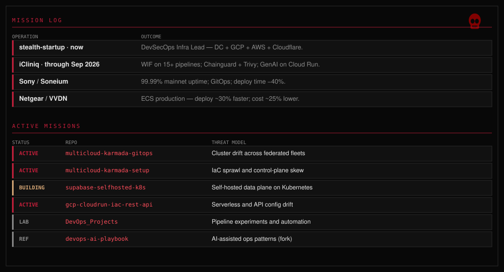
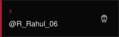
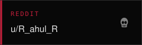

# Rahul R

**Rack to region — one perimeter, one pipeline.**

DevSecOps infrastructure lead at **stealth-startup** · data center and cloud (GCP, AWS, Cloudflare).

<!-- python3 assets/hybrid-perimeter.py -->

  <picture>
    <source media="(prefers-color-scheme: dark)" srcset="assets/hybrid-perimeter-dark.svg">
    <source media="(prefers-color-scheme: light)" srcset="assets/hybrid-perimeter.svg">
    
  </picture>

Interactive repo zones: open <a href="assets/hybrid-perimeter.svg">full perimeter map</a> · inventory links on <a href="assets/character-card.svg">operator card</a>.

<!-- Daily: .github/workflows/contrib-target.yml → output branch (not a snake). -->

  <picture>
    <source media="(prefers-color-scheme: dark)" srcset="https://raw.githubusercontent.com/Rahul-ramakrishnan06/Rahul-ramakrishnan06/output/contrib-target-dark.svg">
    <source media="(prefers-color-scheme: light)" srcset="https://raw.githubusercontent.com/Rahul-ramakrishnan06/Rahul-ramakrishnan06/output/contrib-target.svg">
    
  </picture>

<!-- python3 assets/runbook-strip.py -->

  

## A bit of play

<!-- python3 assets/character-card.py && python3 assets/journey.py -->

  <picture>
    <source media="(prefers-color-scheme: dark)" srcset="assets/character-card-dark.svg">
    <source media="(prefers-color-scheme: light)" srcset="assets/character-card.svg">
    
  </picture>

  <picture>
    <source media="(prefers-color-scheme: dark)" srcset="assets/journey-dark.svg">
    <source media="(prefers-color-scheme: light)" srcset="assets/journey.svg">
    
  </picture>

<a href="GAME.md"><strong>▶ Play Night patrol</strong></a> — one-minute text adventure (replaces the snake game).

## Mission intel

<!-- python3 assets/missions-board.py -->

  <a href="assets/missions-board.svg">
    <picture>
      <source media="(prefers-color-scheme: dark)" srcset="assets/missions-board-dark.svg">
      <source media="(prefers-color-scheme: light)" srcset="assets/missions-board.svg">
      
    </picture>
  </a>

## Contact

<!-- python3 assets/contact-cards.py -->

  
  
  
  
  

