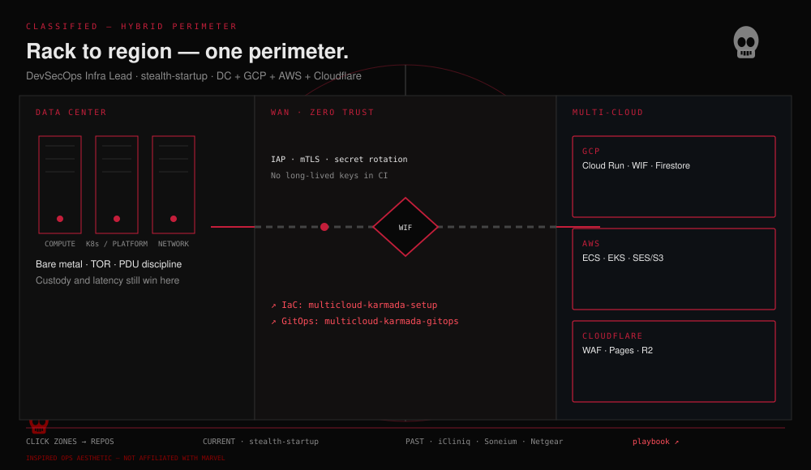
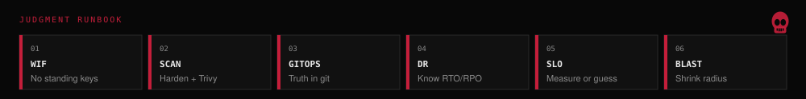

# Rahul R

**Rack to region — one perimeter, one pipeline.**

DevSecOps infrastructure lead at **stealth-startup** · data center and cloud (GCP, AWS, Cloudflare).

<!-- python3 assets/hybrid-perimeter.py -->

  

<!-- python3 assets/runbook-strip.py -->

  

## Mission log

| Operation | Outcome |
| :--- | :--- |
| **stealth-startup** · now | DevSecOps Infra Lead — DC + GCP + AWS + Cloudflare. |
| **iCliniq** · through Sep 2026 | Multi-cloud healthcare — WIF on 15+ pipelines; Chainguard + Trivy; GenAI on Cloud Run. |
| **Sony / Soneium** | L1/L2 blockchain — ArgoCD & Helm; 99.99% mainnet uptime; deploy time −40%. |
| **Netgear / VVDN** | ECS production — faster deploys (~30%), lower cloud cost (~25%). |

## Active missions

| Status | Repo | Threat model |
| :--- | :--- | :--- |
| ACTIVE | [multicloud-karmada-gitops](https://github.com/Rahul-ramakrishnan06/multicloud-karmada-gitops) | Cluster drift across federated fleets |
| ACTIVE | [multicloud-karmada-setup](https://github.com/Rahul-ramakrishnan06/multicloud-karmada-setup) | IaC sprawl and control-plane skew |
| BUILDING | [supabase-selfhosted-k8s](https://github.com/Rahul-ramakrishnan06/supabase-selfhosted-k8s) | Self-hosted data plane on Kubernetes |
| ACTIVE | [gcp-cloudrun-iac-rest-api](https://github.com/Rahul-ramakrishnan06/gcp-cloudrun-iac-rest-api) | Serverless and API config drift |
| LAB | [DevOps_Projects](https://github.com/Rahul-ramakrishnan06/DevOps_Projects) | Pipeline experiments |
| REF | [devops-ai-playbook](https://github.com/Rahul-ramakrishnan06/devops-ai-playbook) | AI-assisted ops (fork) |

  <a href="GAME.md"><strong>Incident at 03:00</strong></a> — four choices, one minute, real repos.

## War journal

  

  

## Contact

<!-- python3 assets/contact-cards.py -->

  
  
  

